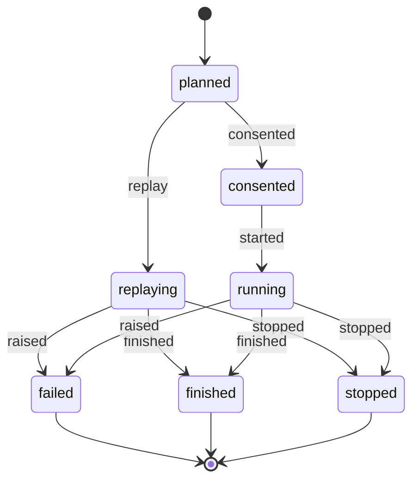
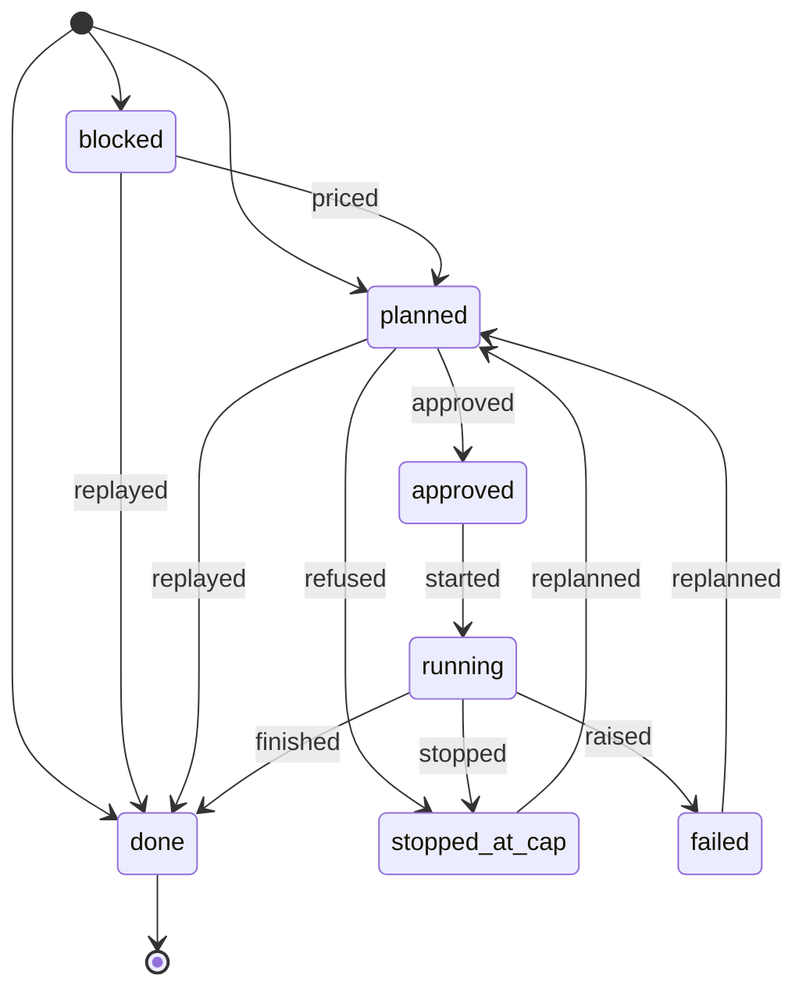
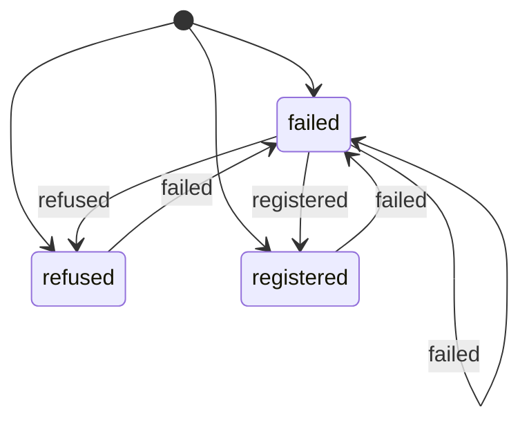

# Decision-variance front door

Point the decision-variance pipeline at a trace file and run everything after it with one
command and one consent: the project build, decision tagging, tag clusters, environment
families, per-family rules, registered starts, and the six-stage pipeline for every start.
Every step resumes from its saved artifacts.

## Run it

Write a `FrontDoorSpec` (`exp/optimize/evaluation/variance/frontdoor.py`) and pass it to the
`decision-variance` continuation action as `front_door`:

```json
{"action": "decision-variance",
 "decision_variance": {"front_door": "front-door.json", "execute": false},
 "spend": {"ceiling_usd": 50.0, "unpriced_attempts": 100000}}
```

```bash
exp eval PROJECT --root ROOT --continuations plan.json
```

The spec has four parts:

- `traces`: the trace file or directory (`path`, `source`, optional gateway `identity`); a
  directory, such as a folder of agent session files, is digested over its sorted relative
  paths and file bytes. Omit it to use the project's completed build as it is.
- `preparation`: a `BootstrapPreparationSpec` (variance build with environment families and
  a compatibility reviewer, bootstrap roles, finite limits).
- `pipeline`: a `PipelineTemplate`, every pipeline setting except the build and the start;
  `mining.job` and `mining.bootstrap` stay empty because each registered start fills them.
- `slots`: settings for stages other owners add (see below).

The default output is the dry run: every phase with its state, then the completed work, the
remaining priced calls, the unpriced components (including phases that can only be priced once
an earlier phase exists) and the state machines below. With `"execute": true` the action asks
consent once and runs or resumes.

## Phases

1. `project-build`: `exp build --non-interactive --yes --skip-learning` runs in a subprocess
   over the trace source. Consent to the plan digest is its confirmation, including an
   embedding estimate above the build budget or an undefined one; the build's default learning
   pass, which the plan does not price, is skipped. A `front-door-source` record binds the source
   digest to the build it produced, so a rerun over the same source skips it. On a project with
   no completed build, the plan prices only this phase; every later phase is shown blocked and
   is priced on the way, against the cumulative ceiling, once the build exists.
2. `bootstrap-preparation`: `run_bootstrap_preparation` creates the start-bootstrap batch from
   the build: tags, clusters, the family review and per-family scopes with probe routing,
   family rules learned once and frozen into each family runtime, and one authored, reviewed,
   captured and validated start per selected probe task. Nothing is registered by hand.
3. `pipeline <task>`: one `run_decision_variance` per registered start, with the saved build
   pinned and `mining.bootstrap` bound to that start. The rules stage reuses the family's
   frozen rules with no call.

The actor horizon of each start defaults to the full length of its longest source trajectory
(`JobTemplate.maximum_model_calls = None`, within `horizon_ceiling`), so each pipeline plan
prices the real horizon.

## One cumulative ledger

One consent gives one dollar ceiling and one unpriced-attempt allowance for the registration.
`PhaseLedger` (`frontdoor_ledger.py`, saved as `<project runtime>/front-door/<spec>/ledger.json`)
is never reset and never split per tier or start. Before a phase starts, its bound from its
owner's plan of the work it will run is reserved; a bound that does not fit what is left is
refused before the phase starts (`stopped_at_cap`). After the phase, its measured usage
replaces the reservation. Before each phase the run shows its dry-run view: completed work,
the phase's remaining calls, its unpriced components and what is left of the ledger.

## Self-hosted Clef

Clef is the default decision alias (`DEFAULT_DECISION_ALIAS`) for tagging, TraceML, rule
memory and recall, error tags and behavioral differences, with no fallback. Serve it with
SGLang on the SystemOne wire and reach it through a loopback tunnel:

```toml
[connections.clef-local]
provider = "typesafe"
base_url = "http://127.0.0.1:30001/v1"
self_hosted = true

[models.clef]
connection = "clef-local"
model = "Cloudflare/clef"
revision = "cfddda043dd190ef3b01cff449d5ee8cff1e8ec6"
billing_source = "customer_managed"
```

`self_hosted` is accepted only for the `typesafe` provider and only with a loopback base URL;
plain HTTP to any other host, or a custom origin without the flag, is refused. Every model on
the connection must pin its weights `revision`. The connection identity omits the port, so
moving a tunnel does not change the model snapshot or any cache key.

## State machines

Each phase and the run move only through these tables (`frontdoor_states.py`); every move is
checked, an illegal one is refused, and each is appended to
`<project runtime>/front-door/<spec>/transitions.jsonl`.

Run:



Phase:



Bootstrap task status (`bootstrap_states.py`, journaled beside the batch manifest):



## Slots

`frontdoor_slots.py` gives every slot a fixed position and binds it to its owner's executor
(`frontdoor_executors.py`). Each executor prices its work credential-free and runs or replays
it against the preparation's saved families.

| Slot | Position | What runs |
|---|---|---|
| `tag-banks` | after the families review | per family, `corpus_tag_bank` (author, select, publish), then every member tagged with `authored_bank_for_view` per view by the decision model |
| `task-types` | after the families review | `task_types` over the families, the task-view matrix and the authored matrices; `task_type_family` narrows a family to one type |
| `state-rag` | after the families review | per family, `authored_state_tags` over sampled pre-turn states and `build_state_tag_index` over every fit step; each family's index (`state_recall`) and the `state_memory` policy enter the runtime template every start is captured in, so the preparation waits for this slot |
| `rule-admission` | after preparation | the family rules were admitted by corpus-wide decision tags inside the preparation (`admission = "rule_tags"` by default, `family=` passed to the rules stage, trajectories priced); the slot records and checks each family's guard table, which served worlds enforce through `guard_rulebook` and `check_proposed_transition` |
| `blast-radius` | after the pipelines | runs inside error mining under `pipeline.mining.qualification` with blast reviewers: the bar answered over every step, justified picks (`check_picks`), `schedule_points` without a fixed K, blast radius across tiers, families ordered by `order_by_blast`; the slot collects each start's ranking |
| `curriculum` | after the pipelines | runs inside records under `pipeline.records.schedule`: `judged_attempts` per tier, `difficulty_tiers`, `merge_curriculum`, `curriculum_plan` in every tier's schedule; the slot collects each start's curricula |
| `dense-hybrid` | after the pipelines | runs inside records under `pipeline.records.dense.hybrid` (and `authoring.adversarial` for reviewed reward-hacking linters); the slot collects each start's training records |

An in-pipeline slot whose template setting is missing is refused when the registration is
validated, so a registration never silently skips a stage it asked for.
